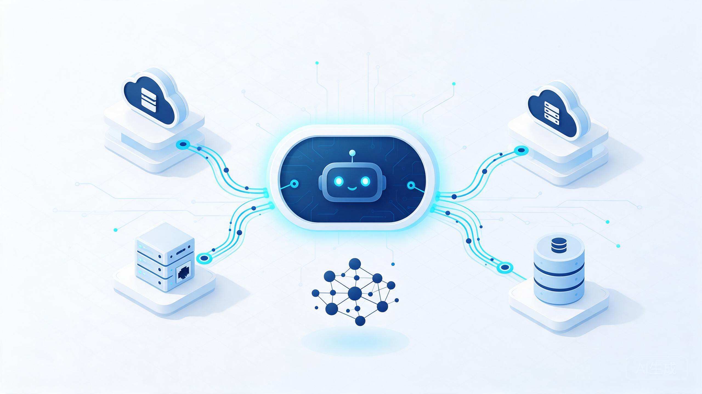
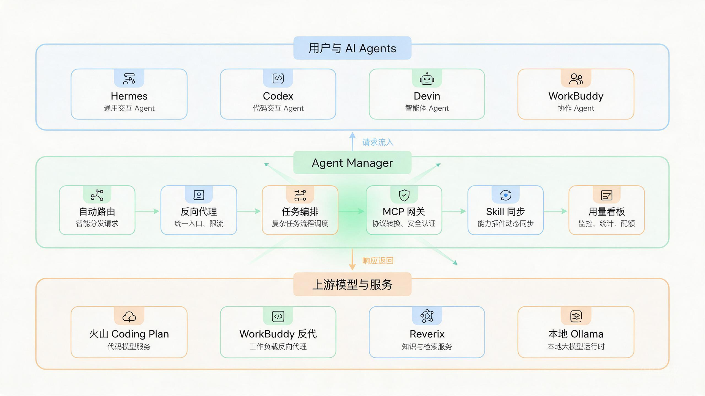
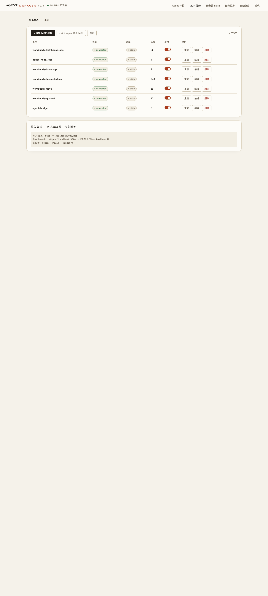
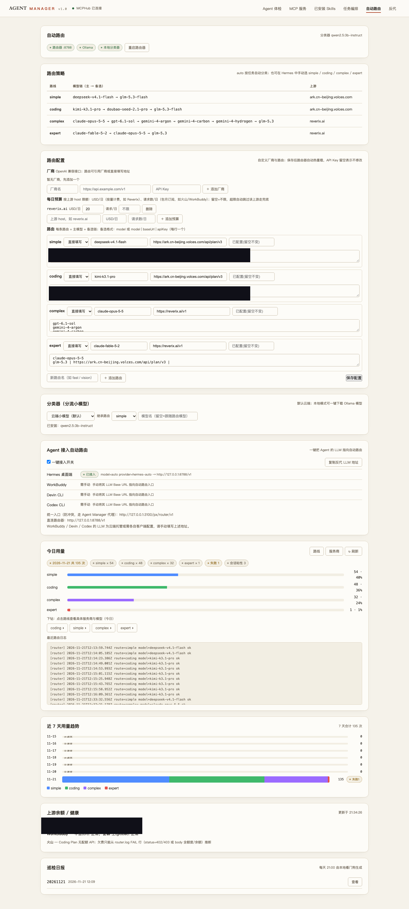
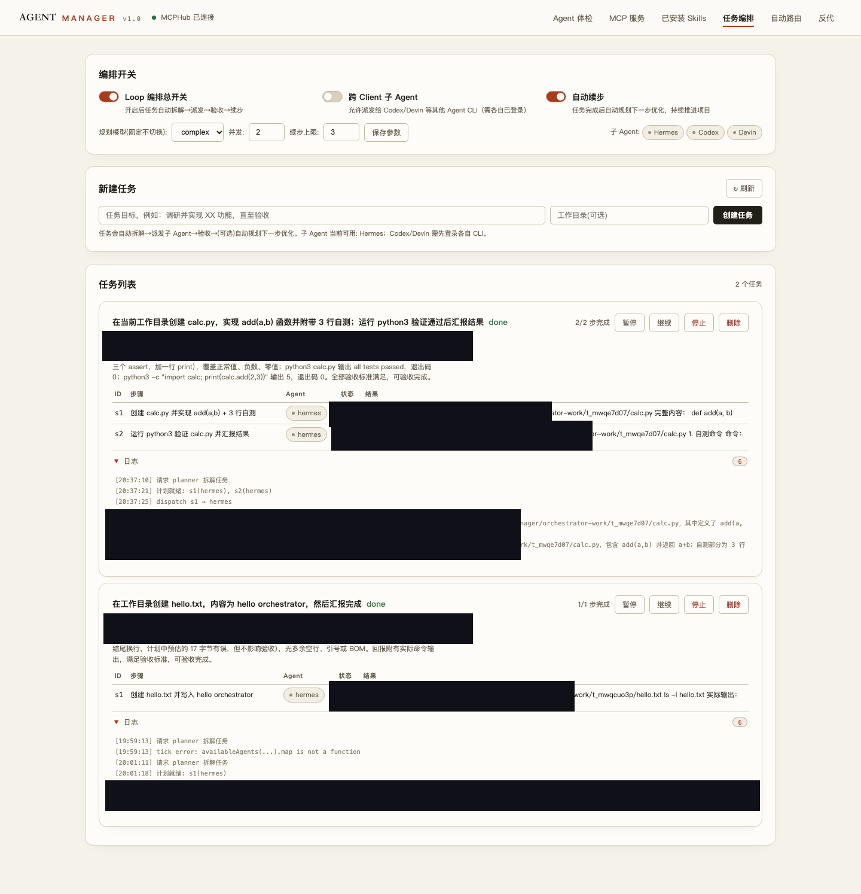

[English](README.en.md) · [中文](README.md)

<p align="center">
  
</p>

<h1 align="center">Agent Manager</h1>

<p align="center"><b>Let every AI Agent on your machine share tools, memory, and model routing</b><br/>Unified multi-Agent management · Cross-Agent memory inheritance · MCPHub path reuse · LLM smart routing · Task orchestration loop</p>

<p align="center">
  
  
  
  
  
  
</p>

<table>
<tr><td align="center" width="25%">
<b>🧠 Cross-Agent Memory</b><br/>Switch Agents without re-explaining — conversations and conclusions are visible to everyone
</td><td align="center" width="25%">
<b>♻️ Path Reuse</b><br/>A workflow discovered in one conversation is distilled through MCPHub into a shared capability
</td><td align="center" width="25%">
<b>🧭 Smart Routing</b><br/>Simple questions go to cheap models; complex tasks get the flagship
</td><td align="center" width="25%">
<b>🌳 Task Orchestration</b><br/>Sub-Agent pool + execution tree + self-healing + automatic continuation
</td></tr>
</table>

> The Hermes, WorkBuddy, Codex, Devin, Windsurf, Claude... on your machine each have their own set of MCPs, Skills, sessions and model configurations that don't talk to each other. **Agent Manager connects them into one whole**: install a tool once and every Agent can use it; have a conversation once and every Agent can read it; figure out a workflow once and every Agent can reuse it; every request automatically picks the most suitable (and most cost-effective) model.

---

## Why You Need It

| Pain point | Without Agent Manager | With Agent Manager |
|---|---|---|
| Switching Agents means re-explaining context | Each Agent only sees its own conversations | Any Agent can search and read the current or other Agents' sessions and shared memory |
| Repeatedly hitting the same pitfalls | Agent A figured out image generation; Agent B starts from scratch | Agent B calls the tool Agent A distilled via MCPHub directly, reproducing Agent A's path |
| Tool configuration silos | MCP / Skills installed separately for each Agent | MCPHub gateway and Skills auto-imported/synced to every Agent |
| Model costs spiraling out of control | Even casual chat is billed at flagship rates | Tiered classifier routing + daily budget circuit breaker |
| Nobody watching long tasks | Manual breakdown, manual dispatch, manual acceptance | Orchestrator breaks down → sub-Agents run in parallel → acceptance and rework → automatic continuation loop |



---

## Features at a Glance

| Feature | One-liner | Detailed docs |
|---|---|---|
| 🧠 **Cross-Agent conversations & memory inheritance** | Any Agent can search / read other Agents' sessions; conclusions are written to a shared memory store | [cross-agent-memory.md](docs/cross-agent-memory.md) |
| ♻️ **MCPHub gateway & path reuse** | All MCPs converge into one gateway; an implementation path from one conversation is distilled into a shared capability | [mcp-gateway.md](docs/mcp-gateway.md) |
| 🧩 **Unified Skill sync** | Install a Skill once and it's rolled out to every Agent; one-click installs from the marketplace | [skills.md](docs/skills.md) |
| 🧭 **LLM smart routing** | Tiered dispatch by simple / coding / complex / expert, session stickiness, budget circuit breaker | [routing.md](docs/routing.md) |
| 🔀 **Reverse proxy / unified entry point** | One entry point aggregating all local services and LLM upstreams, with SSE streaming passthrough | [proxy.md](docs/proxy.md) |
| 🌳 **Multi-Agent task orchestration** | Sub-Agent pool, cross-Client scheduling, execution tree, failure self-healing, automatic continuation loop | [orchestration.md](docs/orchestration.md) |
| 📊 **Usage dashboard & daily inspection report** | Usage drill-down, provider views, 7-day trends, daily automated health checks | [dashboard.md](docs/dashboard.md) |

---

## Highlights

### 🧠 Cross-Agent conversations & memory inheritance

Built-in MCP server **agent-bridge**, automatically registered into the gateway so every Agent can call it:

```text
User → Codex: continue the database migration plan we discussed with Hermes yesterday
Codex → conversations_search("database migration")       # searches sessions across all Agents
Codex → conversation_read(agent="hermes", id=…)          # reads full context and picks up where it left off
```

Supports same-system (your own historical sessions) and cross-system (Hermes / Devin / Codex / WorkBuddy reading each other), plus the `memory_save` / `memory_search` shared memory store. → [Details](docs/cross-agent-memory.md)

### ♻️ MCPHub path reuse: distill a conversation's workflow

```text
① Agent A's conversation configures and uses an image-generation MCP ──(auto-import)──▶ MCPHub gateway
② Agent B's new conversation: "help me generate an image"
③ Agent B checks the gateway catalog / searches sessions ──▶ discovers the tool Agent A used, already in the gateway
④ Agent B calls the same tool through MCPHub, reproducing Agent A's call path
```

**Tools are distilled into MCPHub; usage is distilled into sessions and memory** — any Agent facing a similar need can reuse it directly, and the more it's used, the stronger every Agent gets. → [Details](docs/mcp-gateway.md)

<p align="center"></p>

### 🧭 LLM smart routing

An OpenAI-compatible local proxy that classifies task difficulty and dispatches accordingly:

| Route | Use cases | Default model |
|---|---|---|
| `simple` | Chat, Q&A, translation | deepseek-v4.1-flash |
| `coding` | Writing code, running commands, MCP tool calls | kimi-k3.1-pro |
| `complex` | Architecture design, complex analysis, planning | claude-opus-5-5 |
| `expert` | Manually designated highest-difficulty tasks | claude-fable-5-2 |

Cloud / local Ollama dual-mode classifier · session stickiness · multi-level fallback · daily budget circuit breaker · custom providers · hot reload · one-click Agent onboarding. → [Details](docs/routing.md)

<p align="center"></p>

### 🌳 Multi-Agent task orchestration

Natural-language goal → breakdown → sub-Agent pool parallel execution → acceptance → rework / human arbitration → automatic continuation loop.

- **Sub-Agent pool**: multiple instances per Client, idle-first scheduling, automatic scaling
- **Cross-Client scheduling**: the orchestration model decides which of Hermes / Codex / Devin each step goes to
- **Execution tree**: the trunk is the orchestration loop, branches are sub-Agents, real-time status, click to see details
- **Failure self-healing**: insufficient quota / network interruption / LLM errors are auto-classified → retried → cooled down → Client switched

→ [Details](docs/orchestration.md)

<p align="center"></p>

### 🔀 Reverse proxy · 🧩 Skill sync · 📊 Usage dashboard

- Proxy: `/px/<id>/` aggregates all local services; `/px/router/v1` is the shared model entry point for every Agent → [proxy.md](docs/proxy.md)
- Skills: symlinked into every Agent, one-click installs from the marketplace, Agent health checks → [skills.md](docs/skills.md)
- Dashboard: usage drill-down, provider views, 7-day trends, balances, daily inspection reports → [dashboard.md](docs/dashboard.md)

---

## Quick Start

### Dependencies

| Dependency | Notes |
|---|---|
| Node.js ≥ 18 (22 LTS recommended) | Runs all services |
| python3 | agent-bridge MCP server (bundled with macOS) |
| `@samanhappy/mcphub` | MCP gateway (optional, `npm i -g`) |
| `agent-skill-manager` (asm) | Skill management (optional, `npm i -g`) |
| Ollama (optional) | Local classifier, `brew install ollama` |

### Install

```bash
git clone https://github.com/PingYan-wang/agent-manager.git && cd agent-manager
./install.sh            # checks dependencies, generates config.json, installs launchd services
```

Open the Web UI (default `http://localhost:3100`). Tabs support hash deep-links such as `/#router` and `/#orch`.

### Set up smart routing (optional but recommended)

```bash
mkdir -p ~/.hermes/router
cp router/config.example.json ~/.hermes/router/config.json
node router/router.mjs &
```

Then one-click onboard Hermes in "Auto-routing → Agent onboarding"; for other Agents, just change the Base URL to the proxy entry `/px/router/v1`.

---

## API Overview

| Endpoint | Description |
|---|---|
| `GET/PUT /api/router/config` | Routing config (redacted read / save triggers hot reload) |
| `GET /api/router/{status,stats,balance,trend,model-usage}` | Routing health, usage, balance, trends, drill-down |
| `GET/POST /api/router/local-models` · `/pull` | Ollama local models |
| `GET /api/proxy/*` | Reverse proxy entry management |
| `GET/POST /api/orchestrator/tasks` · `.../review` | Orchestration tasks and human arbitration |
| `GET/POST /api/orchestrator/agent-pool` | Sub-Agent pool |

See `server.js` and each feature doc for the full API.

## Directory Structure

```
server.js               # HTTP service + all APIs + auto-sync
orchestrator.js         # Task orchestration engine (sub-Agent pool / execution tree / failure self-healing / continuation)
public/index.html       # Chinese Web UI
router/                 # LLM smart routing proxy + config template
tools/agent-bridge/     # Cross-Agent session reading + shared memory MCP server
tools/mcp-monitor.js    # MCP health monitoring
skills/agent-ecosystem/ # Built-in Skill: ecosystem capability guide
launchd/                # launchd plist templates
docs/                   # Feature docs, screenshots, architecture diagram
```

## Security Notes

- All config files containing API keys are gitignored; example files contain placeholders only
- The router and proxy listen on localhost only — do not expose them to the public internet
- Set a daily budget cap for all pay-per-use upstreams

## Roadmap

- [ ] Routing quality metrics dashboard (success rate / rework count / token cost)
- [ ] Per-deployment cooldown + exponential backoff
- [ ] Standalone verify agent for acceptance
- [ ] Role-ized orchestration workers (researcher / reviewer / tester)
- [ ] RouteLLM local routing model

## License

MIT
