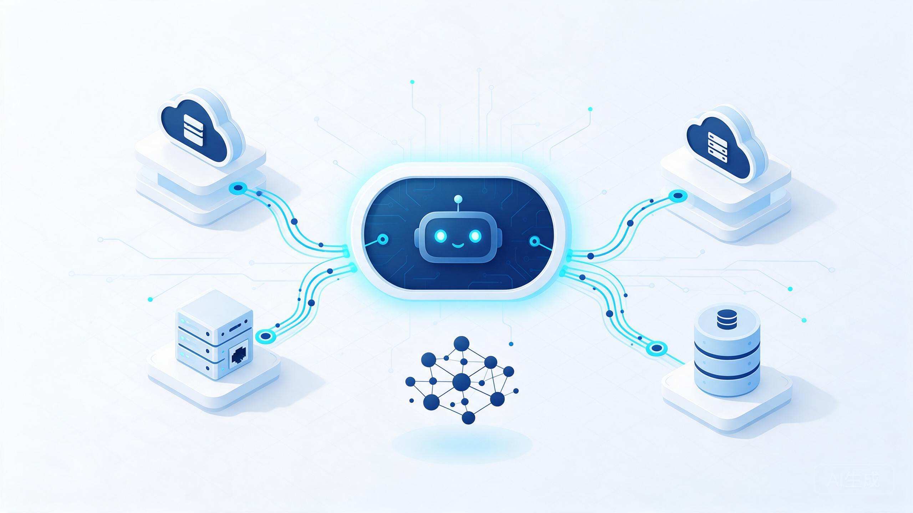
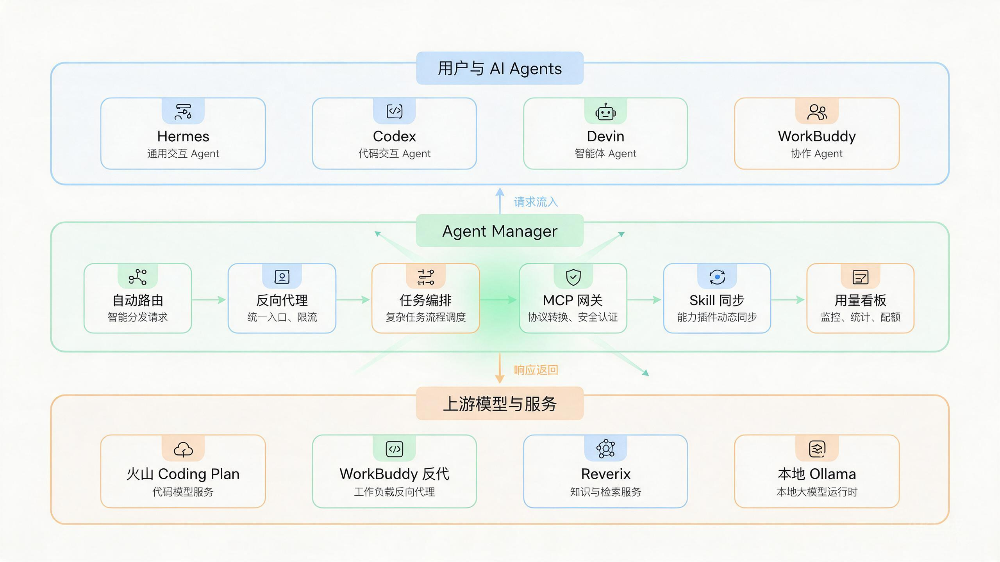
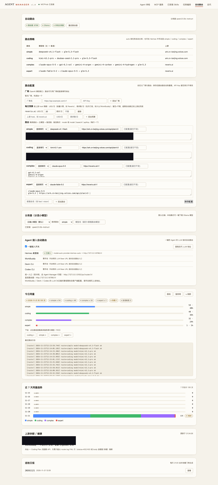
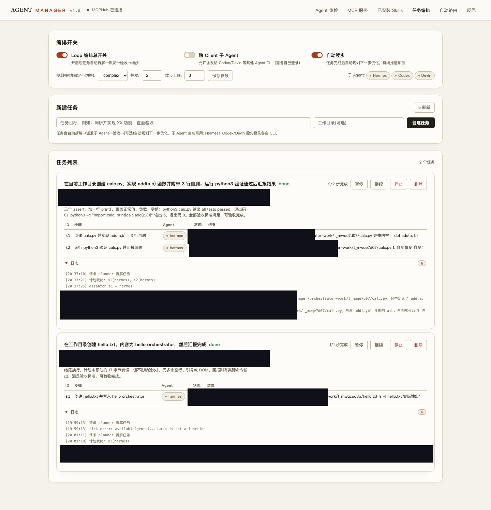

[English](README.en.md) · [中文](README.md)

<p align="center">
  
</p>

<h1 align="center">Agent Manager</h1>

<p align="center"><b>让本机所有 AI Agent 共享工具、共享记忆、共享模型路由</b><br/>多 Agent 统一管理 · 跨 Agent 记忆继承 · MCPHub 路径复用 · LLM 智能路由 · 任务编排 loop</p>

<p align="center">
  
  
  
  
  
  
</p>

<table>
<tr><td align="center" width="25%">
<b>🧠 跨 Agent 记忆</b><br/>换个 Agent 不用重讲，会话与结论全员可查
</td><td align="center" width="25%">
<b>♻️ 路径复用</b><br/>一个对话摸索出的做法，经 MCPHub 沉淀为全员能力
</td><td align="center" width="25%">
<b>🧭 智能路由</b><br/>简单问题走便宜模型，复杂任务才上旗舰
</td><td align="center" width="25%">
<b>🌳 任务编排</b><br/>子 Agent 池 + 执行树 + 失败自愈 + 自动续步
</td></tr>
</table>

> 你电脑上的 Hermes、WorkBuddy、Codex、Devin、Windsurf、Claude……各自有一套 MCP、Skill、会话和模型配置，互不相通。**Agent Manager 把它们连成一个整体**：工具装一次全员可用，对话聊一次全员可查，做法摸索一次全员复用，每个请求自动挑最合适（也最省钱）的模型。

---

## 为什么需要它

| 痛点 | 没有 Agent Manager | 有 Agent Manager |
|---|---|---|
| 换 Agent 要重讲背景 | 每个 Agent 只看得到自己的对话 | 任一 Agent 可搜索、读取当前或其他 Agent 的会话和共享记忆 |
| 同一件事反复踩坑 | A 对话配好了生图，B 对话从零再来 | B 通过 MCPHub 直接调用 A 沉淀下来的工具，复现 A 的路径 |
| 工具配置孤岛 | MCP / Skill 每个 Agent 各装一遍 | 自动导入 MCPHub 网关、Skill 同步到所有 Agent |
| 模型成本失控 | 闲聊也按旗舰模型计费 | 分类器分级路由 + 每日预算熔断 |
| 长任务没人盯 | 手动拆解、手动派发、手动验收 | 编排器拆解→子 Agent 并行→验收返工→自动续步 |



---

## 功能一览

| 功能 | 一句话 |
|---|---|
| [🧠 **跨 Agent 对话与记忆继承**](docs/cross-agent-memory.md) | 任一 Agent 可搜索 / 读取其他 Agent 的会话，结论写入共享记忆库 |
| [♻️ **MCPHub 网关与路径复用**](docs/mcp-gateway.md) | 所有 MCP 汇入一个网关；一个对话的实现路径沉淀为全员能力 |
| [🧩 **Skill 统一同步**](docs/skills.md) | Skill 装一次铺到所有 Agent，市场一键安装 |
| [🧭 **LLM 智能路由**](docs/routing.md) | simple / coding / complex / expert 分级分流，会话粘性，预算熔断 |
| [🔀 **反向代理 / 统一入口**](docs/proxy.md) | 一个入口聚合所有本地服务与 LLM 上游，SSE 流式透传 |
| [🌳 **多 Agent 任务编排**](docs/orchestration.md) | 子 Agent 池、跨 Client 调度、递归拆解、执行树、失败自愈、自动续步 loop |
| [📊 **用量看板与巡检日报**](docs/dashboard.md) | 用量下钻、服务商视图、7 天趋势、每日自动体检 |

---

## 亮点

### 🧠 跨 Agent 对话与记忆继承

内置 MCP server **agent-bridge**，自动注册进网关，所有 Agent 都能调用：

```text
用户 → Codex：接着 Hermes 昨天讨论的数据库迁移方案继续
Codex → conversations_search("数据库迁移")       # 搜遍全部 Agent 的会话
Codex → conversation_read(agent="hermes", id=…)  # 读到完整上下文，直接接着做
```

支持同系统（自己的历史会话）与跨系统（Hermes / Devin / Codex / WorkBuddy 互读），以及 `memory_save` / `memory_search` 共享记忆库。→ [详细说明](docs/cross-agent-memory.md)

### ♻️ MCPHub 路径复用：把一次对话的做法沉淀下来

```text
① Agent A 的对话里配置并用过生图 MCP ──(自动导入)──▶ MCPHub 网关
② Agent B 的新对话："帮我生成一张图"
③ Agent B 查网关目录 / 搜索会话 ──▶ 发现 A 用过、网关里已有该工具
④ Agent B 通过 MCPHub 直接调用同一工具，复现 A 的调用路径
```

**工具沉淀进 MCPHub，用法沉淀进会话与记忆**——任何 Agent 遇到同类需求都能直接复用，用得越多，所有 Agent 一起变强。→ [详细说明](docs/mcp-gateway.md)

<p align="center"></p>

### 🧭 LLM 智能路由

OpenAI 兼容本地代理，分类器判断任务等级后分流：

| 路由 | 适用场景 | 默认模型 |
|---|---|---|
| `simple` | 闲聊、问答、翻译 | deepseek-v4.1-flash |
| `coding` | 写代码、跑命令、MCP 工具调用 | kimi-k3.1-pro |
| `complex` | 架构设计、复杂分析、规划 | claude-opus-5-5 |
| `expert` | 手动指定的最高难度任务 | claude-fable-5-2 |

云端 / 本地 Ollama 双模式分类器 · 会话粘性 · 多级 fallback · 每日预算熔断 · 自定义厂商 · 热重载 · Agent 一键接入。→ [详细说明](docs/routing.md)

<p align="center"></p>

### 🌳 多 Agent 任务编排

自然语言目标 → 拆解 → 子 Agent 池并行执行 → 验收 → 返工 / 人工裁决 → 自动续步 loop。

- **子 Agent 池**：一个 Client 可建多个实例，空闲优先、自动扩容
- **跨 Client 调度**：由编排模型判断每步交给 Hermes / Codex / Devin 中的哪一个
- **执行树**：树干是编排 loop，分叉是子 Agent，实时状态、点击看详情
- **失败自愈**：额度不足 / 网络中断 / LLM 异常自动分类 → 重试 → 冷却 → 切换 Client

→ [详细说明](docs/orchestration.md)

<p align="center"></p>

### 🔀 反向代理 · 🧩 Skill 同步 · 📊 用量看板

- 反代：`/px/<id>/` 聚合所有本地服务，`/px/router/v1` 是全员共用的模型入口 → [proxy.md](docs/proxy.md)
- Skill：symlink 铺到每个 Agent，市场一键安装，Agent 体检 → [skills.md](docs/skills.md)
- 看板：用量下钻、服务商视图、7 天趋势、余额、每日巡检日报 → [dashboard.md](docs/dashboard.md)

---

## 快速开始

### 依赖

| 依赖 | 说明 |
|---|---|
| Node.js ≥ 18（推荐 22 LTS） | 运行全部服务 |
| python3 | agent-bridge MCP server（macOS 自带） |
| `@samanhappy/mcphub` | MCP 网关（可选，`npm i -g`） |
| `agent-skill-manager` (asm) | Skill 管理（可选，`npm i -g`） |
| Ollama（可选） | 本地分类器，`brew install ollama` |

### 安装

```bash
git clone https://github.com/PingYan-wang/agent-manager.git && cd agent-manager
./install.sh            # 检查依赖、生成 config.json、安装 launchd 服务
```

打开 Web UI（默认 `http://localhost:3100`）。标签页支持 hash 直达，如 `/#router`、`/#orch`。

### 接入智能路由（可选但推荐）

```bash
mkdir -p ~/.hermes/router
cp router/config.example.json ~/.hermes/router/config.json
node router/router.mjs &
```

然后在「自动路由 → Agent 接入」一键接入 Hermes；其他 Agent 把 Base URL 改为反代入口 `/px/router/v1` 即可。

---

## API 概览

| 端点 | 说明 |
|---|---|
| `GET/PUT /api/router/config` | 路由配置（脱敏读取 / 保存即热重载） |
| `GET /api/router/{status,stats,balance,trend,model-usage}` | 路由健康、用量、余额、趋势、下钻 |
| `GET/POST /api/router/local-models` · `/pull` | Ollama 本地模型 |
| `GET /api/proxy/*` | 反代条目管理 |
| `GET/POST /api/orchestrator/tasks` · `.../review` | 编排任务与人工裁决 |
| `GET/POST /api/orchestrator/agent-pool` | 子 Agent 池 |

完整 API 见 `server.js` 与各功能文档。

## 目录结构

```
server.js               # HTTP 服务 + 全部 API + 自动同步
orchestrator.js         # 任务编排引擎（子 Agent 池 / 执行树 / 失败自愈 / 续步）
public/index.html       # 中文 Web UI
router/                 # LLM 智能路由代理 + 配置模板
tools/agent-bridge/     # 跨 Agent 会话读取 + 共享记忆 MCP server
tools/mcp-monitor.js    # MCP 健康监控
skills/agent-ecosystem/ # 内置 Skill：生态能力说明书
launchd/                # launchd plist 模板
docs/                   # 功能文档、截图、架构图
```

## 安全说明

- 含 API Key 的配置文件均已 gitignore，示例文件只有占位符
- 路由器与反代仅监听本机，不要暴露到公网
- 建议对所有按量计费上游设置每日预算上限

## Roadmap

- [ ] 路由质量指标看板（成功率 / 返工次数 / token 成本）
- [ ] per-deployment cooldown + 指数退避
- [ ] 独立 verify agent 验收
- [ ] 编排 worker 角色化（researcher / reviewer / tester）
- [ ] RouteLLM 本地路由模型

## 致谢

- 感谢 WorkBuddy「苏格拉底学习法」递归学习项目的设计灵感——执行树的主干/分叉视觉语言与「拆到能执行为止、再逐层整合」的递归拆解思路，均受其启发
- 感谢 MCPHub 提供的跨 Agent 桥接与记忆基座，让「路径沉淀」成为可能
- 感谢 Hermes / Codex / Devin 等开源 Agent 生态的开发者与使用者

如果这个项目对你有帮助，欢迎 Star 与反馈 🙏

## License

MIT
