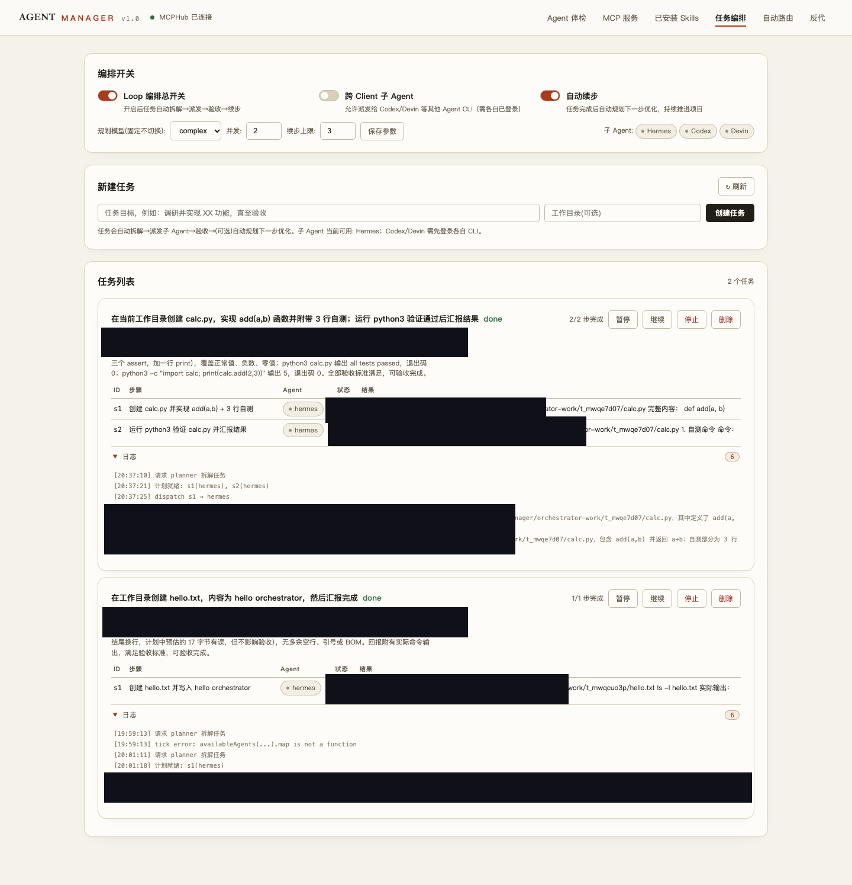

[English](orchestration.en.md) · [中文](orchestration.md)

# Multi-Agent Task Orchestration

[← Back to README](../README.md)

<p align="center"></p>

Natural-language goal → automatic breakdown → parallel sub-agent execution → acceptance review → rework / human arbitration → auto-continue loop.

## Flow

1. **Planning**: the planner (always routed through `complex`) breaks the goal into a step graph with dependencies
2. **Dispatch**: each step is dispatched to a sub-agent for headless execution — hermes(`-z`) / codex(`exec`) / devin(`-p`)
3. **Debate (optional)**: when a step is marked `needsDebate`, two sub-agents argue the pro and con sides and the planner synthesizes
4. **Acceptance**: after all steps finish, the planner reviews; on failure it auto-reworks (default ≤3 rounds)
5. **Human arbitration**: if it still fails, the task enters `awaiting_review`; the UI offers Approve / Rework again / Terminate, with a 24h timeout auto-terminating
6. **Auto-continue loop**: once complete, the next optimization goal is planned automatically (configurable cap), driving continuous goal-directed progress

## Sub-Agent Pool

- One client can create multiple agent instances (e.g. hermes ×3), managed under "Orchestration Settings → Sub-Agent Pool"
- The scheduler prefers idle instances and auto-scales within the concurrency quota; each instance is an independent headless session
- **Cross-client sub-agents** (toggle): when enabled, the orchestration model decides which client each step is dispatched to; when disabled, everything uses the client specified by "single-client mode"

## Execution Tree

The task detail view shows the **execution tree** by default (switchable back to the conversation view):

- **Trunk** = the orchestration loop: goal → plan → acceptance → rework → human arbitration → continuation
- **Branches** = the individual steps executed by sub-agents, showing real-time Running / Retrying / Done / Failed / Awaiting review
- Click any node to expand details: execution instance, attempt count, failure reason

## Recursive Breakdown

Inspired by the Socratic "break down until executable, then merge back layer by layer": when a sub-agent judges a step too complex to finish in one go, it can write `<<<SPLIT>>>` on the first line of its output, followed by JSON describing 2–6 smaller sub-steps:

```json
{"steps":[{"title":"调研 X","prompt":"自包含提示词","agent":"hermes"}]}
```

- Sub-steps execute recursively as **next-level sub-agents**; on the execution tree the parent step shows "broken down" and sub-steps hang beneath it
- When all sub-steps complete they are **automatically merged back into the parent step** (layer-by-layer consolidation); if any sub-step fails, the parent step is marked failed
- Breakdown depth is limited by `maxDepth` (default 2 levels); requests beyond the limit are ignored to prevent infinite recursion
- The "Plan" view shows all steps, their dependencies, and completion progress

## Failure Self-Healing

When a sub-agent fails, it is automatically classified and handled:

| Failure type | Detection | Handling |
|---|---|---|
| Quota exhausted | quota / 429 / insufficient balance | instance cools down for 30 minutes, immediately switch to a backup client |
| Network error | ECONN / timeout / fetch failed | retry on the same instance; on further failure cool down 5 minutes and switch |
| LLM error | other errors | same as above |

Up to 3 attempts; if still failing, it falls through to acceptance → rework → human arbitration. Every retry is recorded on the execution tree.

## Configuration

`enabled` · `crossClient` · `workerClient` · `autoContinue` · `maxContinuations` · `maxConcurrent` · `maxRepairs` · `maxDepth` · `tickSeconds` · `dispatchTimeoutMs` — all editable on the fly in the "Orchestration Settings" drawer.

## API

| Endpoint | Description |
|---|---|
| `GET/PUT /api/orchestrator/config` | Orchestration config |
| `GET/POST /api/orchestrator/tasks` | Task list / create (`goal` / `workdir` / `client`) |
| `GET/DELETE /api/orchestrator/tasks/<id>` | Detail (includes `tree`) / delete |
| `POST /api/orchestrator/tasks/<id>/{pause,resume,stop,review}` | Control and human arbitration |
| `GET/POST /api/orchestrator/agent-pool` · `DELETE .../<id>` | Sub-agent pool |
