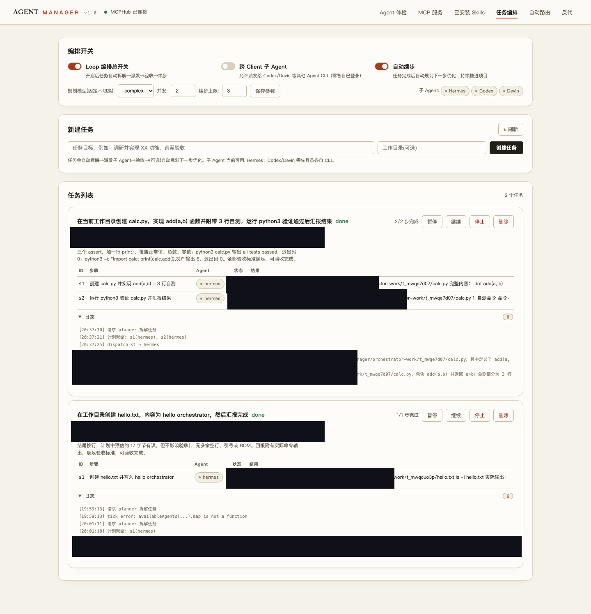

[English](orchestration.en.md) · [中文](orchestration.md)

# 多 Agent 任务编排

[← 返回 README](../README.md)

<p align="center"></p>

自然语言目标 → 自动拆解 → 子 Agent 并行执行 → 验收 → 返工 / 人工裁决 → 自动续步 loop。

## 流程

1. **规划**：planner（固定走 `complex` 路由）把目标拆成带依赖的步骤图
2. **派发**：每个步骤派给子 Agent 无头执行——hermes(`-z`) / codex(`exec`) / devin(`-p`)
3. **辩论（可选）**：步骤标记 `needsDebate` 时，两个子 Agent 分别做正方 / 反方，planner 综合
4. **验收**：全部步骤结束后 planner 验收；不通过自动返工（默认 ≤3 轮）
5. **人工裁决**：仍不通过进入 `awaiting_review`，UI 提供 通过 / 再返工 / 终止，24h 超时自动终止
6. **自动续步 loop**：完成后自动规划下一步优化目标（上限可配），目标驱动持续推进

## 子 Agent 池

- 一个 Client 可创建多个 Agent 实例（如 hermes ×3），在「编排设置 → 子 Agent 池」中管理
- 调度器优先选空闲实例，并发额度内自动扩容；每个实例是独立的无头会话
- **跨 Client 子 Agent**（开关）：开启后由编排模型按步骤判断派给哪个 Client；关闭时统一用「单 Client 模式」指定的 Client

## 执行树

任务详情默认显示**执行树**（可切换回对话视图）：

- **树干** = 编排 loop：目标 → 计划 → 验收 → 返工 → 人工裁决 → 续步
- **分叉** = 子 Agent 执行的各个步骤，实时显示 执行中 / 重试中 / 完成 / 失败 / 待裁决
- 点击任一节点展开详情：执行实例、尝试次数、失败原因

## 递归拆解

借鉴苏格拉底式「拆到能执行为止，再逐层往回整合」：当子 Agent 判断某步骤过于复杂、无法一次完成时，可在输出首行写 `<<<SPLIT>>>`，随后用 JSON 给出 2–6 个更小的子步骤：

```json
{"steps":[{"title":"调研 X","prompt":"自包含提示词","agent":"hermes"}]}
```

- 子步骤作为**下一层子 Agent** 递归执行，执行树上父步骤显示为「已拆解」，子步骤挂在其下
- 全部子步骤完成后**自动合并回父步骤**（逐层整合）；任一子步骤失败则父步骤标记失败
- 拆解深度由 `maxDepth` 限制（默认 2 层），超限忽略拆解请求，防止无限递归
- 「计划」视图可查看全部步骤、依赖关系与完成进度

## 失败自愈

子 Agent 失败时自动分类并处理：

| 失败类型 | 判定 | 处理 |
|---|---|---|
| 额度不足 | quota / 429 / 余额不足 | 实例冷却 30 分钟，直接切换备选 Client |
| 网络异常 | ECONN / timeout / fetch failed | 同实例重试，再失败冷却 5 分钟并切换 |
| LLM 异常 | 其他错误 | 同上 |

最多 3 次尝试，仍失败则交给验收 → 返工 → 人工裁决流程。每次重试都记录在执行树上。

## 配置项

`enabled` · `crossClient` · `workerClient` · `autoContinue` · `maxContinuations` · `maxConcurrent` · `maxRepairs` · `maxDepth` · `tickSeconds` · `dispatchTimeoutMs`——均可在「编排设置」抽屉中即时修改。

## API

| 端点 | 说明 |
|---|---|
| `GET/PUT /api/orchestrator/config` | 编排配置 |
| `GET/POST /api/orchestrator/tasks` | 任务列表 / 创建（`goal` / `workdir` / `client`） |
| `GET/DELETE /api/orchestrator/tasks/<id>` | 详情（含 `tree`）/ 删除 |
| `POST /api/orchestrator/tasks/<id>/{pause,resume,stop,review}` | 控制与人工裁决 |
| `GET/POST /api/orchestrator/agent-pool` · `DELETE .../<id>` | 子 Agent 池 |
