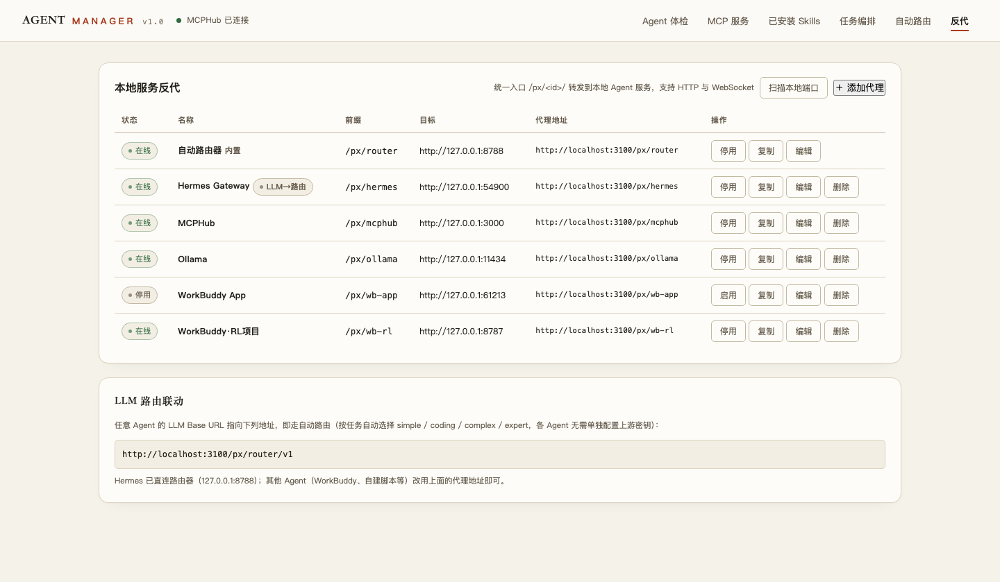

[English](proxy.en.md) · [中文](proxy.md)

# Reverse Proxy / Unified Entry Point

[← Back to README](../README.md)

Built-in `/px/<id>/` prefix reverse proxy (HTTP + WebSocket, SSE streaming passthrough):

- **One entry aggregating all local services**: hermes / mcphub / ollama / trae / any port — add, edit, delete, start/stop, health probes, port scanning
- **LLM routing integration**: `/px/router/v1` is the shared model entry point for all agents; requests automatically go through smart routing — any tool that supports the OpenAI-compatible API just needs this one address; `/px/trae/v1` points directly at the local `trae2api-web` service
- **Conflict prevention**: when multiple agents access different LLM upstreams at once, the proxy + router consolidate everything, so they no longer connect directly and compete over ports or configs

The proxy and router listen on localhost only by default; do not expose them to the public internet.

## Related

- [LLM Smart Routing](routing.en.md)
