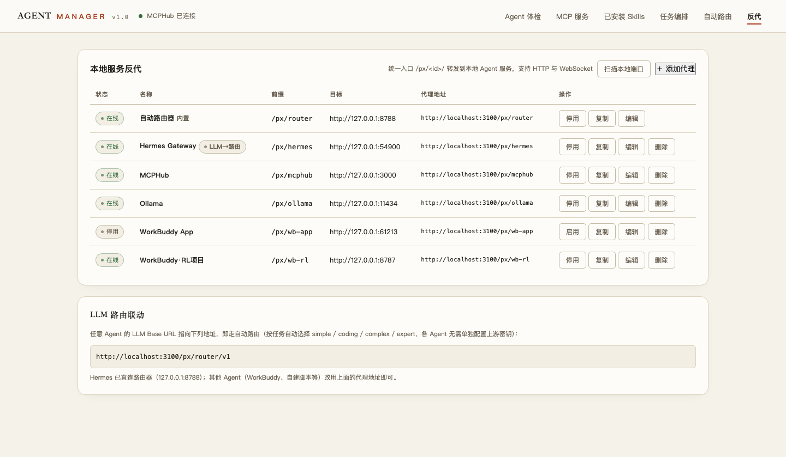

[English](proxy.en.md) · [中文](proxy.md)

# 反向代理 / 统一入口

[← 返回 README](../README.md)

内置 `/px/<id>/` 前缀反代（HTTP + WebSocket，SSE 流式透传）：

- **一个入口聚合所有本地服务**：hermes / mcphub / ollama / 任意端口，增删改、启停、健康探测、端口扫描
- **LLM 路由联动**：`/px/router/v1` 是所有 Agent 共用的模型入口，请求自动走智能路由——支持 OpenAI 兼容接口的工具改这一个地址即可
- **防冲突**：多个 Agent 同时访问不同 LLM 上游时，统一由反代 + 路由收口，不再各自直连、互相抢端口或配置

反代与路由器默认只监听本机，不要暴露到公网。

## 相关

- [LLM 智能路由](routing.md)
