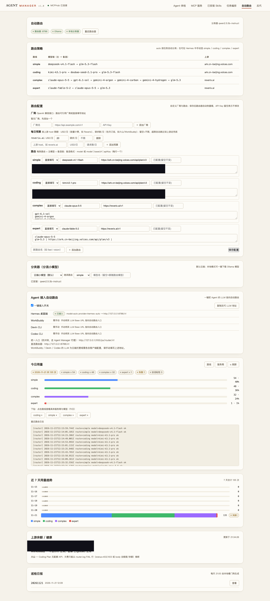

[English](routing.en.md) · [中文](routing.md)

# LLM Smart Routing

[← Back to README](../README.md)

<p align="center"></p>

An OpenAI-compatible local proxy (`router/router.mjs`, listening on `127.0.0.1:8788`). Every request first goes through a **classifier** that judges the task difficulty tier, then routes to the corresponding upstream.

## Routing Tiers

| Route | Suitable for | Default model |
|---|---|---|
| `simple` | Chit-chat, Q&A, translation, weather/news | deepseek-v4.1-flash |
| `coding` | Writing code, running commands, file operations, MCP tool calls | kimi-k3.1-pro |
| `complex` | Architecture design, complex analysis, planning | claude-opus-5-5 |
| `expert` | Manually designated hardest tasks | claude-fable-5-2 |

Routes, models, and fallback chains can all be customized in the UI, and new routes (e.g. `fast` / `vision`) can be added.

## Core Mechanisms

- **Dual-mode classifier**: cloud small model (default, reuses existing upstreams, zero deployment) or local Ollama small model (one-click `ollama pull` in the UI, fully offline); can also probe each upstream's `/models` list to pick directly
- **Session stickiness**: follow-up messages within the same session ("continue / ok / sure") do not get downgraded, preserving prompt cache and context
- **Tool-intent override**: reminders / email / PDF / screenshots and similar tasks route deterministically to coding, without relying on the classifier to guess
- **Multi-level fallback**: if the primary model fails, fallback chains are tried in order and can mix across upstreams (`model | baseUrl | apiKey`)
- **Budget circuit breaker**: per-upstream-host daily budget (`usd` for pay-as-you-go / `requests` for monthly subscriptions); over-limit upstreams are automatically skipped in favor of fallbacks
- **Hot reload**: saving in the UI takes effect immediately (`/admin/reload`), with automatic backup before changes; API keys are masked and left blank to keep unchanged
- **Custom vendors**: add any OpenAI-compatible vendor (name + baseUrl + key)
- **One-click agent onboarding**: switch Hermes to `model=auto` with one click; for other agents just change the Base URL to the proxy entry (a master switch can disable this)

## Configuration

```bash
mkdir -p ~/.hermes/router
cp router/config.example.json ~/.hermes/router/config.json
node router/router.mjs
```

| Field | Description |
|---|---|
| `routes.<name>` | `baseUrl` / `apiKey` / `model` / `fallbacks[]` |
| `classifier.mode` | `cloud` (default) or `local` (Ollama) |
| `classifier.route` / `classifier.model` | Route and model the cloud classifier inherits |
| `budgets.<host>` | `{ "usd": 20 }` or `{ "requests": 5000 }` |
| `upstreamTimeoutMs` | Upstream timeout (default 600s, compatible with slow reasoning models) |

## Related

- [Reverse Proxy](proxy.en.md) · [Usage Dashboard](dashboard.en.md)
