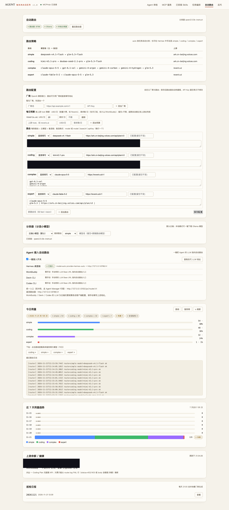

[English](routing.en.md) · [中文](routing.md)

# LLM 智能路由

[← 返回 README](../README.md)

<p align="center"></p>

一个 OpenAI 兼容的本地代理（`router/router.mjs`，监听 `127.0.0.1:8788`）。每个请求先由**分类器**判断任务等级，再按该等级的**厂商分组链路**依次尝试，并根据失败原因决定「换模型」还是「换厂商」。

## 路由分级

| 路由 | 适用场景 | 典型主模型 |
|---|---|---|
| `simple` | 闲聊、问答、翻译、天气新闻 | deepseek-v4.1-flash |
| `coding` | 写代码、跑命令、文件操作、MCP 工具调用 | kimi-k3.1-pro |
| `complex` | 架构设计、复杂分析、规划 | claude-opus-5-5 |
| `expert` | 手动指定的最高难度任务 | claude-fable-5-2 |

路由、厂商、链路均可在 UI 中自定义，也可新增路由（如 `fast` / `vision`）。

UI 里的链路是「**厂商下拉 + 模型可搜索输入框**」：点开就能选现成模型，也可以直接敲一个新名字（不做存在性校验，照原样保存）。模型候选来自三处，优先级从高到低：

1. 厂商的 `GET /v1/models`（服务端缓存 10 分钟，点「↻ 刷新模型清单」可强制重拉）
2. 配置里已经出现过的模型
3. 路由器日志里真实跑过的模型（按 `provider=` 归集）

上游不提供 `/models` 时（例如火山的 plan 端点返回 404）自动退回后两者，所以下拉里不会是空的。每个厂商组内可以上下调整模型顺序（顺序即同厂商内的降级顺序），组与组之间也可以上下调整或整体删除。

## 链路 = 厂商分组

每条路由的链路是**有序的厂商分组**，组内是**有序模型**：

```json
"coding": {
  "chain": [
    { "provider": "ark",     "models": ["kimi-k3.1-pro", "doubao-seed-2.1-pro"] },
    { "provider": "wb",      "models": ["glm-5.3-flash"] },
    { "provider": "reverix", "models": ["claude-opus-5-5", "gpt-6.1-sol"] }
  ]
}
```

顺序即优先级。**同一厂商内先换模型，整家不可用才换下一家厂商**——这是和「把所有备选模型平铺成一条链」最大的区别：余额/配额/鉴权这类失败对同一账号下的所有模型同时成立，平铺链会在同一家厂商上白白烧掉 5 次尝试。

## 失败归因

| 归因 | 典型信号 | 处理 |
|---|---|---|
| **模型级** | 模型不存在 / 参数不被支持 / 上下文超限 / 单模型不可用（400、404 model、422） | 换同厂商的下一个模型 |
| **能力级**（400 的一个子类） | `does not support thinking`、`tools is not supported`、`protocol conversion ... messages.reasoning_content`、`response_format` 不支持 | 先**就地剥掉对应字段**重试同一目标一次；仍失败才换模型 |
| **厂商级** | 余额不足、配额耗尽（402 / 403 `insufficient_user_quota` / 429 `AccountQuotaExceeded`）、鉴权失败（401）、连不上（DNS/TLS/超时） | 跳过该厂商**剩余全部模型**，按顺序换下一家 |
| **限流**（429 的独立子类） | `rate limit`、`requests per 1 minute`、`too many requests`、`限流` | 同样整家跳过，但只冷却 **60 秒**（能解析 `per N minute` 就按窗口）——绝不能当 15 分钟配额耗尽 |
| **单模型 5xx** | 5xx 且文案指向模型（`Model service temporarily unavailable`、`choose another available model`） | 第一次只冷却**这个模型**、换同厂商下一个；同一厂商**连续两次 5xx** 才整家熔断 |
| **请求级** | 只有真正不可解析：JSON 非法、`"messages" is required`、body 为空 | 不再尝试任何模型，直接把错误回给客户端 |

三个附带优化：

- **参数自愈**：上游返回 `temperature only 0.6 is allowed` 这类 400 时，就地改写参数重试同一目标一次，不算失败、不熔断厂商。
- **能力降级**：`reasoning_effort` / `tools` / `response_format` / `max_completion_tokens` 不被某个上游支持时，剥掉该字段重试；日志记 `fix=<label>`，失败记录带 `dropped=N`。
- **请求级快速失败**：`RE_FATAL_REQ` 只匹配「消息结构缺失 / JSON 不可解析」。**其它未知 400 一律继续兜底**，不再把上游的能力限制当成客户端的错——否则 Agent 客户端会弹出「拒绝此请求，请新建聊天」，用户明明什么都没做错。

> 全部候选失败时的状态码语义：只有请求级致命错误回 `400`，其余回 `502`（或全熔断 `503 + Retry-After`，限流 `429`）。这样客户端会把失败当成**服务故障**重试，而不是当成「这轮对话结构不被接受」而逼用户新建会话。

## 出站净化（思维链回显）

Agent 客户端会把上一轮 assistant 的思维链原样回传。这些字段是**客户端本地状态**，上游多半不认：

| 位置 | 剥掉的字段 | 会踩的坑 |
|---|---|---|
| 顶层 | `reasoning_effort`、`reasoning`、`think`、`thinking`、`verbosity`、`prompt_cache_key`、`service_tier` … | 本地 Ollama 400 `"qwen2.5:3b-instruct" does not support thinking` |
| 消息 | `reasoning_content`、`reasoning_details`、`thinking_blocks`、`provider_specific_fields`、`cache_control`、`refusal` … | Reverix（OpenAI→Anthropic 转换）400 `cannot preserve ... messages.reasoning_content` |
| content 数组 | `{"type":"thinking"}` / `{"type":"redacted_thinking"}` 块 | 同上；只剩思维链的空消息会被整条丢弃 |

`content` 变空且无 `tool_calls` 的消息直接剔除，避免 `content must not be empty`。若某家厂商确实需要回传，用 `providers.<id>.keepFields: ["reasoning_content"]` 声明保留。

失败日志会带 `shape=[n=12,rc=5,eff=medium,tools=8,stream]`，一眼看出这条请求带了什么而导致 400；`/admin/health` 的 `recentFails` 同样保留该字段。

## 路由策略（strategy）

每一档路由可以带一个策略，只影响**该档内部**的先后顺序，不增删成员、也越不过能力守卫：

```json
"complex": { "strategy": "latency", "chain": [ ... ] }
```

| 策略 | 排序依据 | 适合 |
|---|---|---|
| `priority`（默认） | 完全按 `chain` 里写的顺序 | 想让贵的/强的先上 |
| `latency` | 近期首包（TTFT）EWMA 低的排前，没数据的排后 | 交互式 Agent，怕等 |
| `cost` | `providers.<id>.cost`（USD/1M tokens）低的排前 | 控成本 |
| `healthy` | 近 5 分钟失败次数少的排前，熔断的直接沉底 | 上游不稳定时 |

统计只存在内存里（EWMA 平滑 + 5 分钟失败窗口），重启归零，不写配置文件、不影响可复现性。
`/admin/plan` 会回显 `strategy` 与最终顺序，UI 里每档路由都有策略下拉。

**档位顺序也来自配置**：`retryPolicy.tiers` 显式写了就严格按它（删掉的路由自动剔除）；没写才退回「路由在配置文件里的出现顺序」。所以新增/改名路由不会悄悄改变升级链。

## 能力守卫（别让小模型硬答 Agent 请求）

模型能被调用 ≠ 能胜任。本地 3B 这类模型接不了工具调用，硬答的结果是「一本正经地说我要帮你调工具」——看起来有回复，实际整轮任务已经废了。所以厂商可以声明能力边界：

```json
"local": {
  "baseUrl": "http://127.0.0.1:11434/v1",
  "capabilities": { "tools": false, "stream": true, "maxChars": 6000, "maxMessages": 12, "tiers": ["simple"] }
}
```

| 字段 | 作用 |
|---|---|
| `tools: false` | 请求带 `tools` 时直接跳过该厂商，日志记 `skip=incapable(local:no-tools(19))` |
| `tiers: ["simple"]` | 只接指定档位；`auto` 被分类到 coding/complex 时不会落到它身上 |
| `maxChars` / `maxMessages` | 上下文超过阈值就跳过，避免小模型被长对话压垮 |
| `stream: false` | 流式请求跳过，用于只支持非流式的上游 |

三条配套规则：

- **带工具的请求不当「简单任务」**：客户端即使显式传 `model=simple` 或 `model=auto`，只要请求里带 `tools`，自动升到 `coding`（`guard.upgradeOnTools`，默认开），日志记 `upgrade=simple->coding(tools=19)`。
- **本档没有合格候选就借下一档**：不是等到重试才升档。`simple` 的厂商全熔断/全被能力守卫挡掉时，现场按 `simple→coding→complex→expert` 找第一个「有能力且未熔断」的厂商，日志记 `borrow=coding`、响应头带 `x-router-escalate`；借档时能力判定按**借来的那一档**算，不会因为原档位是 simple 就放行本地小模型。
- **能力死局立刻失败**：过滤完一个候选都不剩（例如只配了本地 3B 却带 19 个工具），直接 `400 router_no_capable_model`，`retryable=false`，不做任何上游尝试。这类请求重试多少次都一样。

## 账号级熔断

厂商级失败会按「厂商账号」熔断，状态落盘到 `breaker-state.json`，粒度是 `baseUrl + key`（同一 host 换 key 视为不同账号）：

- 能解析出**配额重置时间**（如 `It will reset at 2026-11-22 04:06:22 +0800`）就精确到那一刻恢复，否则按类别冷却：配额 15 分钟、鉴权 60 分钟、**限流 60 秒**（能解析 `per N minute` 就按该窗口）、网关 60 秒、网络 30 秒。
- 冷却期内该厂商直接跳过，不再发请求；**全部候选都熔断时**先按下面的「快速失败」判断，该等才返回 `503 + Retry-After`。
- 任一成功即解除熔断。

### 快速失败：别让 Agent 30 秒一轮地空转

WorkBuddy / Devin 这类客户端收到 `503 + Retry-After: 30` 会老老实实等 30 秒再重试，最多 3 次；如果云端账号真的都不可用，这 90 秒纯属浪费。所以下面几种情况直接回 `400`、带 `retryable:false`、**不带 Retry-After**：

| 条件 | 判定 | 错误类型 |
|---|---|---|
| 能力过滤后候选为 0 | 请求形态本身无法被当前配置服务 | `router_no_capable_model` |
| 请求到达前所有候选就已熔断，且最短熔断已存在 ≥ `guard.fastFailStaleMs`（默认 45s） | 故障早就发生，再问也不会变 | `router_cooling` |
| 存在配额/欠费/鉴权类长故障（已存在 ≥ `fastFailStaleMs`）且这是第 2 次以上尝试 | 等 30 秒不会好 | `router_cooling` |
| 同一请求重试次数 ≥ `guard.fastFailAfterRetries`（默认 2）且全部熔断 | 已经给过机会 | `router_cooling` |
| 最早恢复时间 ≥ `guard.fastFailMinWaitMs`（默认 120s） | 等不起 | `router_cooling` |

30 秒的网络型熔断刻意**不**触发快速失败：它是唯一有可能在下一轮恢复的故障，值得让客户端等一次。任一值设为 `0` 可关闭对应规则。


## Agent 重试感知

同一会话的同一句请求，在上一次**失败**后的 5 分钟窗口内再次到达，即判定为 Agent 重试：

| 次数 | 行为 |
|---|---|
| 第 1 次重试 | 跳过上一轮已试过的厂商/模型，从断点继续（不重复已经失败的头部） |
| 第 2 次重试（`retryPolicy.escalateAfter`） | 自动升级到下一档路由（simple → coding → complex → expert）再叠兜底池 |

若断点之后已经无可用候选，则直接升档，不再空跑一轮。可用一次即清空账本，不会影响后续正常对话。

## 其它机制

- **分类器双模式**：云端小模型（默认，沿继承路由的厂商顺序挑第一个未熔断的，零部署）或本地 Ollama 小模型（完全离线）
- **会话粘性**：同一会话内的追问（"继续 / 好的 / ok"）不降级，保住 prompt 缓存
- **工具意图覆盖**：提醒 / 邮件 / PDF / 截图等任务直接确定性路由到 coding
- **兜底池**：`reserve` 里声明跨厂商保底，自动补到每条链路末尾（已出现过的厂商不重复追加，保证厂商顺序）。**云厂商排在本地小模型之前**——本机 3B 只该做最后一档纯聊天兜底，不应在云端还能用的时候抢答
- **能力守卫**：见上文，声明 `capabilities` 的厂商会被自动挡住不合适的请求（工具调用 / 长上下文 / 流式）
- **预算熔断**：按上游 host 设每日预算（`usd` 按量计费 / `requests` 包月订阅），超限跳过走兜底
- **热重载**：UI 保存即生效（`/admin/reload`），改动前自动备份；API Key 脱敏显示、留空不覆盖
- **Agent 一键接入**：一键把 Hermes 切到 `model=auto`；其他 Agent 把 Base URL 改为反代入口即可

## 配置

```bash
mkdir -p ~/.hermes/router
cp router/config.example.json ~/.hermes/router/config.json
node router/router.mjs
```

| 字段 | 说明 |
|---|---|
| `providers.<name>` | `{ baseUrl, apiKey, label?, cost?, capabilities? }`，厂商账号池；`cost` 是 USD/1M tokens，`capabilities` 见能力守卫 |
| `routes.<name>.strategy` | `priority`（默认）/ `latency` / `cost` / `healthy`，只在该档内部重排 |
| `routes.<name>.chain[]` | `{ provider, models[] }`，顺序即优先级；也可用 `{ baseUrl, apiKey, models[] }` 直连 |
| `reserve[]` | 跨厂商兜底池，自动补到每条链路末尾 |
| `guard` | `{ upgradeOnTools, toolsMin, toolsUpgradeTo, fastFailStaleMs, fastFailAfterRetries, fastFailMinWaitMs }` |
| `retryPolicy` | `{ windowMs, escalateAfter, crossTier, tiers[] }`；`tiers` 即升级链，缺省用路由出现顺序 |
| `breaker` | `{ quotaMs, authMs, rateMs, serverMs, networkMs, modelMs }` |
| `classifier.mode` | `cloud`（默认）或 `local`（Ollama） |
| `budgets.<host>` | `{ "usd": 20 }` 或 `{ "requests": 5000 }` |
| `upstreamTimeoutMs` | 上游超时（默认 600s，兼容慢速推理模型） |

## 可观测性

| 入口 | 用途 |
|---|---|
| `GET /healthz` | 路由列表 + 各厂商熔断状态 |
| `GET /admin/health` | 完整状态：熔断原因/剩余时间、模型冷却、链路、最近失败 |
| `GET /admin/plan?route=simple&retry=2` | 预览某档位在指定重试次数下的实际尝试顺序 |
| `POST /admin/breaker/reset` | 手动解除熔断（`{"provider":"ark"}`，留空=全部） |

响应头会带回本次实际使用的 `x-router-provider` / `x-router-model` / `x-router-attempts` / `x-router-retry` / `x-router-escalate`；日志按 `route= model= host= ok|FAIL status= kind= scope= retry=` 输出，可直接被用量看板解析。

## 回归测试

```bash
npm run test:router
```

用本地假上游覆盖：厂商级跳过整家、模型级换模型、参数自愈、请求级快速失败、重试升档、全熔断快速失败、能力死局 400、已知故障快速失败、`strategy=cost` 排序、`tiers` 跟随配置。

## 开源方案对照

写这套路由器前后对照过的主流项目，以及本项目的取舍：

| 项目 | 做法 | 本项目采用 | 不采用的原因 |
|---|---|---|---|
| [LiteLLM](https://github.com/BerriAI/litellm) | 100+ 厂商统一网关；Router 支持 fallbacks、cooldowns、`simple-shuffle` / `least-busy` / `latency-based` / `cost-based` 策略 | 账号级熔断 + 冷却；策略命名与「同档内重排」的思路对齐 latency / cost | Python 网关体量大；本项目只需要单进程、零依赖的 OpenAI 兼容层 |
| [RouteLLM](https://github.com/lm-sys/RouteLLM) | 用偏好数据训练分类器，判断「弱模型够不够」，按阈值在强弱模型间二选一 | 保留「先分类再选档」的结构，分类器可换云端/本地小模型 | 需要训练数据与 ML 依赖；个人场景 4 档已够，且误判成本高于省下的钱 |
| [semantic-router](https://github.com/aurelio-labs/semantic-router) | 用 embedding 相似度匹配意图，微秒级、不调 LLM | 工具意图用确定性正则先拦（`TOOL_INTENT`），命中即 coding | 需要额外向量模型；中文短句用关键词+小模型分类更稳 |
| [vLLM Semantic Router](https://github.com/vllm-project/semantic-router) | Envoy ExtProc + 多信号（意图/复杂度/安全）+ 语义缓存 | 借「信号驱动」思路：请求形状（tools/字符数/消息数/档位）直接参与选路 | 依赖 Envoy/Go 与自建推理集群，单机场景过重 |
| [OpenRouter](https://openrouter.ai/docs/features/provider-routing) | 平台侧 provider routing：`order` / `price` / `throughput` / `latency` 排序 + 自动 failover | `strategy=priority/cost/latency` 与 failover 语义 | 托管服务，密钥与账单不落地；本项目要能直连任意 OpenAI 兼容端点 |
| [Portkey Gateway](https://github.com/Portkey-AI/gateway) | 规则路由 + 指数退避重试 + 条件路由 | 重试感知与退避窗口 | 目标是可观测平台，路由配置模型偏重 |

一个反复被提到的运维结论也在这里落地：**「Fallbacks that never retry errors that will fail again」**——余额不足、鉴权失败、能力不匹配这类错误重试一百次也一样，必须快速失败；只有限流/网络/5xx 值得等下一轮。

## 相关

- [反向代理](proxy.md) · [用量看板](dashboard.md)
