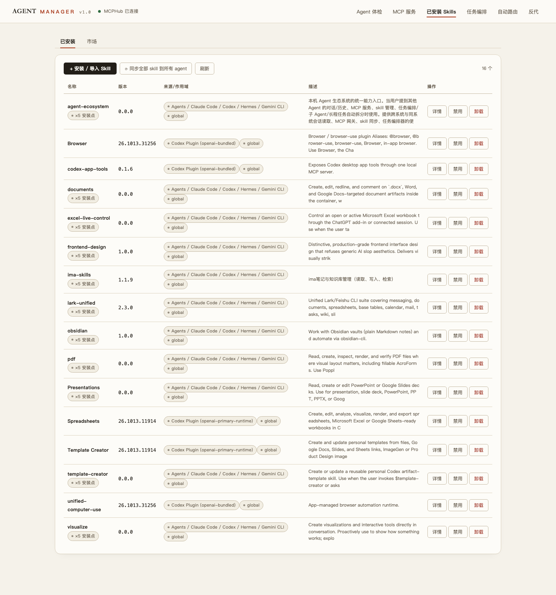

[English](skills.en.md) · [中文](skills.md)

# Unified Skill Sync

[← Back to README](../README.md)

- **Full sync**: skills are laid out via symlinks into every agent's native skill directory — install once, available to all
- **Skill marketplace**: one-click install, automatically synced to all agents afterwards; falls back to direct tarball install when GitHub is unreachable
- **Enable / disable / uninstall / details**: operate from the "Installed Skills" page in the Web UI
- **Agent health check**: automatically detects MCP / skill configuration status across 8+ local agent types, with one-click repair for missing pieces
- **Built-in Skill `agent-ecosystem`**: tells every agent that this machine has a gateway, cross-agent conversations, and task orchestration available

Depends on `agent-skill-manager` (asm): `npm i -g agent-skill-manager`.

## Related

- [MCPHub Gateway and Path Reuse](mcp-gateway.en.md)
