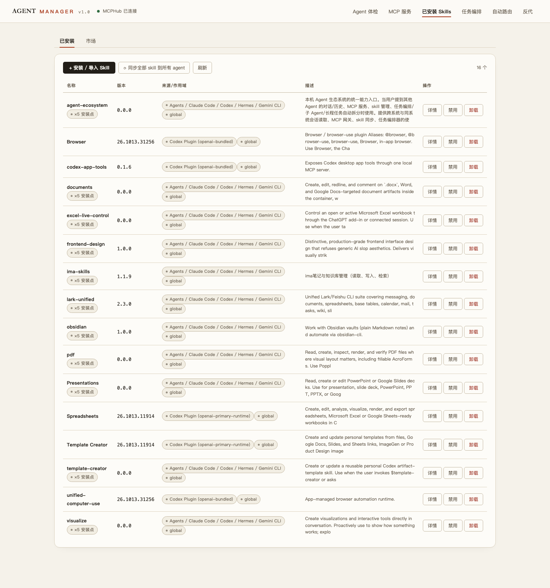

[English](skills.en.md) · [中文](skills.md)

# Skill 统一同步

[← 返回 README](../README.md)

- **全量同步**：Skill 以 symlink 方式铺到每个 Agent 的原生 Skill 目录，装一次全员可用
- **Skill 市场**：一键安装，装完自动同步到所有 Agent；GitHub 不可达时自动用 tarball 直装兜底
- **启用 / 禁用 / 卸载 / 详情**：在 Web UI「已安装 Skills」页操作
- **Agent 体检**：自动检测本机 8+ 种 Agent 的 MCP / Skill 配置状态，缺失一键修复
- **内置 Skill `agent-ecosystem`**：告诉每个 Agent 本机有网关、有跨 Agent 会话、有任务编排可用

依赖 `agent-skill-manager`（asm）：`npm i -g agent-skill-manager`。

## 相关

- [MCPHub 网关与路径复用](mcp-gateway.md)
